# Traccia — local recording and dictation for macOS

English · [Italiano](README.it.md)

**Record your screen, transcribe conversations, or dictate into your apps — with local speech processing.**

Traccia turns what you show and say into files you can read, edit and give to an AI agent. Dictation puts your words directly into the app you were using.

| What you want to do | What Traccia gives you |
|---|---|
| Show a bug, a workflow or an idea on screen | Video or JPG frames, with clicks and an optional voice transcript on one timeline |
| Keep a record of a meeting, interview or conversation in the room | Audio only or audio with screen video, separate microphone and system tracks, and a local transcript with optional speaker labels you can name |
| Write by speaking | A compact dictation badge, automatic stop on silence, and text inserted into the original field when it can be verified; Copy and Edit text otherwise |

Transcription uses Whisper on your Mac. Optional speaker recognition also runs locally. Download the models once from the app; no account or API key is needed for these features. Recording files stay on your disk. If you give them to an AI client through **Copy prompt for AI** or MCP, that client's processing and sharing settings apply.

## Screen recording example

<p align="center">
  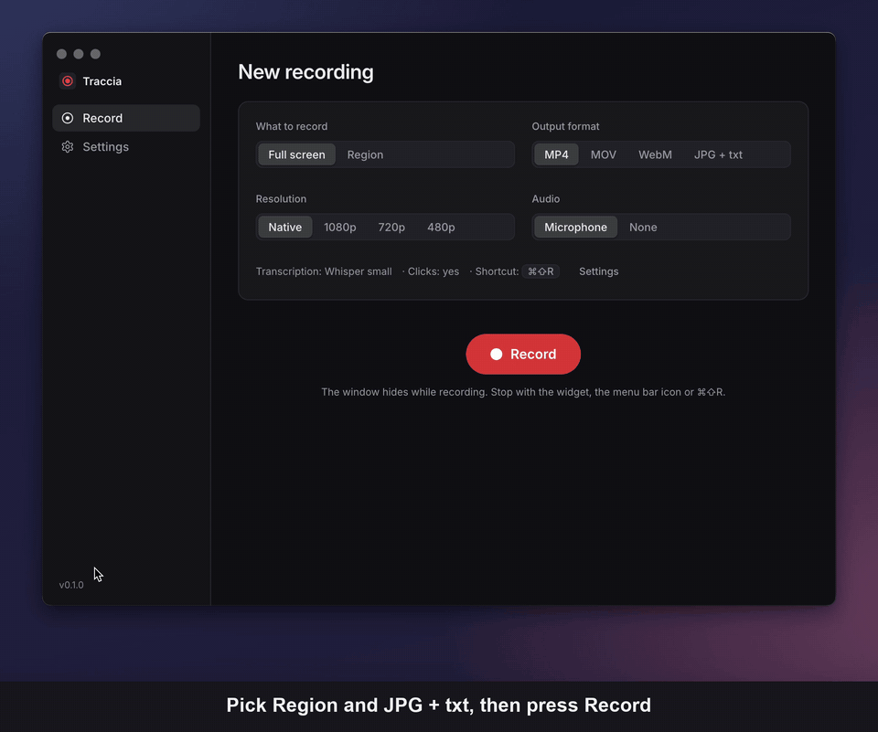
</p>
<p align="center"><sub>Pick <em>Region</em> and <em>JPG + txt</em> → drag the area → record while talking → stop from the widget → frames + <code>recording.txt</code> are ready. <a href="docs/demo.mp4">MP4 version</a>.</sub></p>

## Recording files

Screen and conversation recordings each have their own folder. Its contents depend on the capture mode and enabled options:

- **Media**: `recording.mp4`, `.mov` or `.webm`, a JPG sequence in `frames/`, or `audio.m4a` for audio-only conversations. With a webcam and the clean-copy option enabled, `recording-screen.<format>` keeps the screen unobstructed for the AI; `webcam.webm` preserves the camera track for editing.
- **Separate audio sources**: `microphone.m4a` and `system.m4a`, when captured, synchronized to the recording timeline. These are tracks per source, not separate audio files for each speaker.
- **`recording.txt`**: a text timeline with the enabled click tracking and transcript. Conversations include audio-source labels and, when enabled and available, speaker labels and the names you assign in the editor.
- **`recording-raw.txt`**: the same timeline plus pointer movement for screen recordings, at the configured sampling rate. Audio-only recordings have no pointer or click events.
- **`recording.json`**: structured recording metadata, transcript and captured events for tools to read.
- **`PROMPT.md`**: instructions for an AI agent, with file paths and guidance on reading the recording. **Copy prompt for AI** copies `Read the file …/PROMPT.md and follow its instructions.`; paste it into an agent that can access those files. Conversation prompts ask the agent to summarize the discussion, decisions and next steps; Traccia itself produces the transcript, not a generated summary.

Dictation is separate: it inserts or lets you copy text, without creating a recording folder or permanent history.

The `recording.txt` produced by the demo above (JPG mode, 2 fps):

```
# Traccia — recorded on 9/17/2026, 9:48:49 PM
# Frames: folder frames/ (1416x1060, 2 fps, 10 frames; 17 identical frames skipped), duration 00:13.094
# Audio: microphone, transcribed with Whisper base (language: en)
# Cursor: only mouse clicks are listed (coordinates in image pixels, origin at the top-left corner); the full pointer movement is in recording-raw.txt
#
# Line format:
#   mm:ss.mmm frame <file>                 image captured at that instant
#   mm:ss.mmm click left|right|middle X,Y  mouse click
#   [mm:ss.mmm → mm:ss.mmm] text          transcribed speech

00:00.000 frame frames/frame_00001.jpg
[00:00.000 → 00:04.000] Let me show you how to turn on the VPN for this project.
00:02.500 frame frames/frame_00002.jpg
00:03.000 frame frames/frame_00003.jpg
00:03.500 frame frames/frame_00004.jpg
[00:04.000 → 00:10.000] I open a network tab, enable the VPN toggle, and save the changes.
00:05.500 frame frames/frame_00005.jpg
00:06.000 frame frames/frame_00006.jpg
00:08.000 frame frames/frame_00007.jpg
00:08.500 frame frames/frame_00008.jpg
00:12.000 frame frames/frame_00009.jpg
00:12.500 frame frames/frame_00010.jpg
```

<p align="center">
  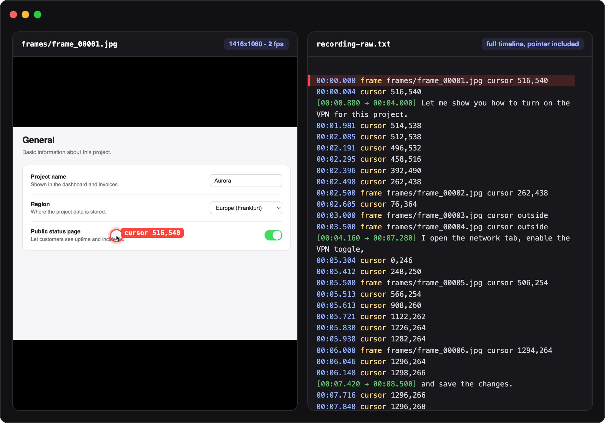
</p>
<p align="center"><sub>The first frame next to its timeline. Coordinates in the text (clicks in <code>recording.txt</code>, pointer positions too in <code>recording-raw.txt</code>) are pixel positions in the image.</sub></p>

## Features

### Screen recording

- Full screen or a region selected by dragging (macOS style).
- Output as MP4, MOV, WebM or **JPG + txt** with configurable frame rate (1, 2, 4…). The choices on the home page (format, resolution, fps, which audio, webcam on or off) apply to the next recording only; the defaults live in Settings.
- Native (Retina), 1080p, 720p or 480p resolution.
- **Webcam in a corner of the video**: circle, square or rectangle, in any corner, chosen on the home page or in Settings with a live preview, and changed (or hidden) from the widget while recording: the video follows from that instant. While recording, a bubble shows it where it will be in the video; like the widget, it is excluded from the capture, and the webcam is recorded on its own and laid over the screen when the video is put together; with the copy without it, its own track is kept too (`webcam.webm`), so the editor can lay it again. By default the AI gets the copy without it (`recording-screen.mp4`), so the webcam never hides part of the screen; without that copy the timeline says which rectangle it covers. Video formats only.
- **Word-level timestamps**: speech is split into short phrases that interleave with the clicks, and every click line also carries the words being spoken at that moment (`click left 820,352 "now I click Save"`).
- Pointer sampled at 120 Hz and global mouse clicks (with the Accessibility permission).
- In JPG mode, frames identical to the previous one (cursor excluded) are skipped.
- Floating widget with timer, Stop and what is being recorded (format, microphone with its level), excluded from the capture; with the webcam, a button opens its shape, corner and Hide above the widget; a red frame outlines the region being recorded, like the macOS recorder. Optional global shortcuts, off by default: the macOS screenshot keys (⇧⌘5 full screen, ⇧⌘4 region), alternative ones (⌃⌥⌘5, ⌃⌥⌘4) or your own, recorded by pressing the keys; either one also stops.

### Conversations and speaker names

- **Conversations**: record meetings, interviews or people in the same room, with the screen or as **audio only (M4A)**. Enable **Recognize multiple speakers** to label voices on both the microphone and system audio. Download the speaker models once from the app (about 45 MB), without an account, token or Python installation; transcription and speaker recognition run locally after recording. Microphone-only audio recording does not request screen capture; system audio still needs the macOS Screen Recording permission, but no video is saved in audio-only mode.
- Speaker recognition uses [pyannote segmentation through sherpa-onnx](https://k2-fsa.github.io/sherpa/onnx/speaker-diarization/models.html) and NVIDIA TitaNet-S, alongside the existing Whisper models. It is a different pipeline from pyannote Community-1. TXT and JSON carry source-scoped speaker IDs such as `microphone_1` and `system_2`; IDs do not identify people by name or match voices across sources. Voice profiles are built from sustained speech across the entire source, including people who join later; short or uncertain utterances do not create new identities on their own. When speaker recognition is enabled, detected speech also guides Whisper to skip long silences while preserving timestamps. Automatic speaker counts and overlapping speech can still be inaccurate; uncertain speech retains its source label. Headphones help prevent remote voices being captured twice. If speaker recognition is unavailable, the transcript retains source labels and a warning. The editor keeps speaker labels and the separate audio sources in sync with cuts and silencing. In the editor, **Speaker names** lets you name each voice; Save updates both TXT transcripts and the JSON (`speakerName`, alongside the stable `speaker` ID), without re-encoding media when only names change. Clear a name to restore its ID.

### Dictation in your apps

- **Local dictation** from the menu bar or an optional configurable global shortcut. A compact badge at the bottom center shows listening without taking focus. After about 1.4 seconds of silence, it transcribes and inserts into the original app automatically, without confirmation. If insertion fails, the text stays available with **Copy** and **Edit text**. Insertion requires macOS Accessibility, checks the original app, field and selection, leaves the text on the clipboard, and never presses Enter. If the field cannot be verified, copy and paste manually. Microphone, Whisper model and language have independent preferences under Settings → Dictation.
- Dictation uses only the microphone, with a five-minute limit and local Whisper processing after silence or manual Stop; eight seconds without speech discard the take without transcribing it; no account, token, screen permission, speaker models or permanent history. Download the Whisper model once in Settings → Audio. Temporary audio is removed after success or discard; a failed transcription can be retried until the panel is closed. Text awaiting recovery remains editable in memory until a new dictation or the app quits. After successful insertion, the badge disappears and the shortcut starts a new dictation. Recording, processing, editing and model operations must finish before dictation can start, and vice versa.

### Audio, editing and everyday use

- Microphone recording and transcription with **Whisper running locally** (models can be downloaded and deleted from the app; audio is processed on your Mac). Choose the spoken language or let Whisper detect it.
- **System audio on macOS** (13 or later): what the computer plays (videos, apps, calls), alone or with the microphone. Microphone and system audio are also saved separately as `microphone.m4a` and `system.m4a`, synchronized to the recording timeline. Screen mode transcribes the microphone; Conversation mode transcribes both sources; if macOS hands over nothing, or only silence, the recording says so instead of keeping a mute track.
- Choice of the microphone (home page, Settings, menu bar), with the live input level under it and in the widget: a silent microphone shows before the take, not after. The choice is kept; if that microphone is not connected, the system default is recorded and the recording says so. A warning flags the reduced sample rate of a microphone in Bluetooth call mode.
- Models already present in the Hugging Face cache (`~/.cache/huggingface/hub`, `HF_HOME`, `HF_HUB_CACHE`) are imported with hard links instead of being downloaded again.
- `PROMPT.md` in every recording folder and a one-click **Copy prompt for AI** (also in the recent recordings list and in the menu bar).
- Recordings can be named and moved to the Trash from the app; a transcription that takes too long can be skipped.
- **Edit** a recording afterwards (**Edit** among its actions): a timeline with a track for the screen (thumbnails), the webcam and the audio (with what was said), and the clicks. Split at the playhead, then cut parts out, put them back, join them again, drag them into another order or drag a cut to shorten a part; undo and redo before saving. On the webcam track a part can hide the webcam or give it another shape and corner while the screen stays as it is (recordings made before this version can only hide it, taking those frames from the copy without it); on the audio track a part can be silenced, and what was said there leaves the transcript too. The video, the frames, the audio, the timeline, the transcript and `PROMPT.md` all follow the edit, in step to the millisecond at every join; the files as they were move to an `original/` folder inside the recording.
- **Smaller copies after recording**: choose **Create a 1080p / 720p / 480p copy** from a recording’s actions, including recent recordings. Only resolutions below its current height are offered. A separate folder contains the resized video or JPGs, with click and pointer coordinates, webcam geometry, both timelines and `PROMPT.md` updated; audio and transcript are preserved. The original stays unchanged.
- Menu bar icon with quick actions: record screen/region, stop, format, resolution, fps, microphone, system audio, transcription, clicks, webcam, recent recordings.
- Open at login (menu-bar-only start), optional Dock icon.
- Interface in English and Italian, light or dark with the system.
- A **CLI and an MCP server** (`traccia-cli`), so an AI agent can read recordings and start or stop one without the app in front.

## Screenshots

These screenshots show the screen recording workflow. Conversation and dictation views are not pictured.

### First run

A four-step wizard: language, macOS permissions, Whisper model, output folder.

<p align="center">
  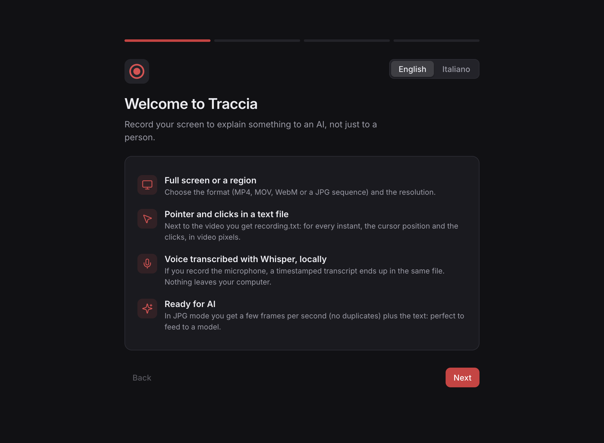
  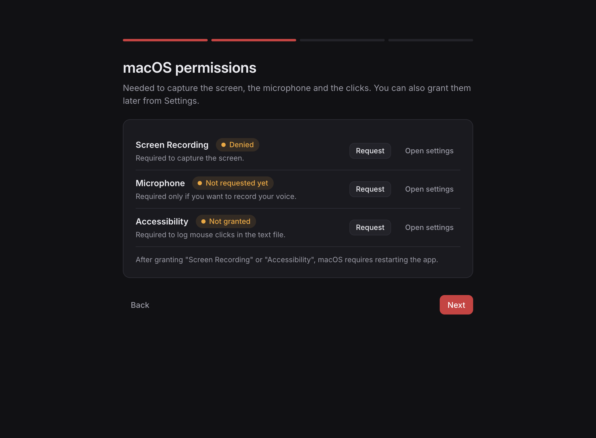
</p>
<p align="center">
  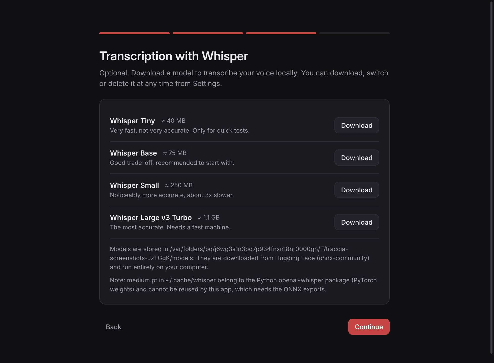
  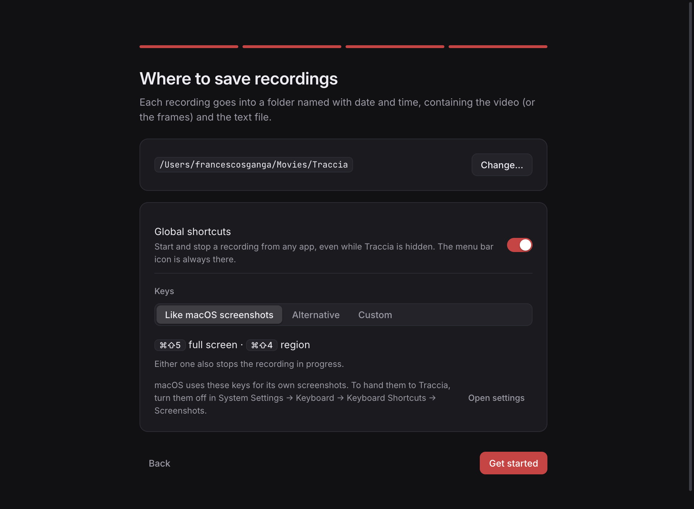
</p>

### Recording

Choose what to capture, the format and the resolution, then record. Dragging a region works like the macOS screenshot tool; while recording the main window hides and a floating widget with the timer stays on top (it is excluded from the capture).

<p align="center">
  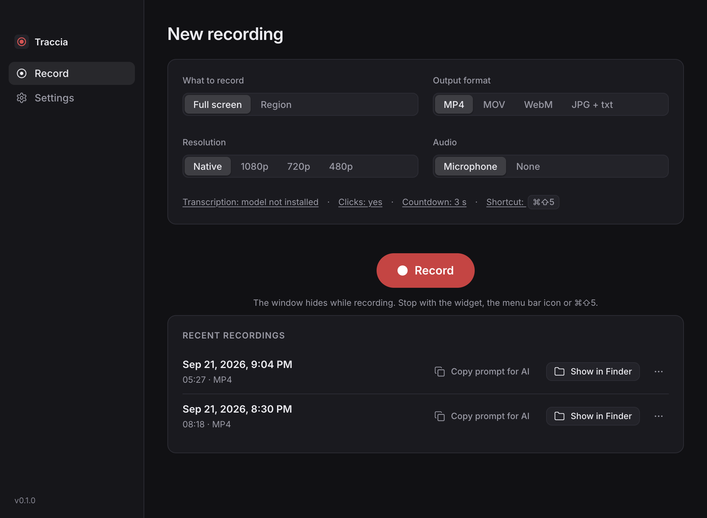
  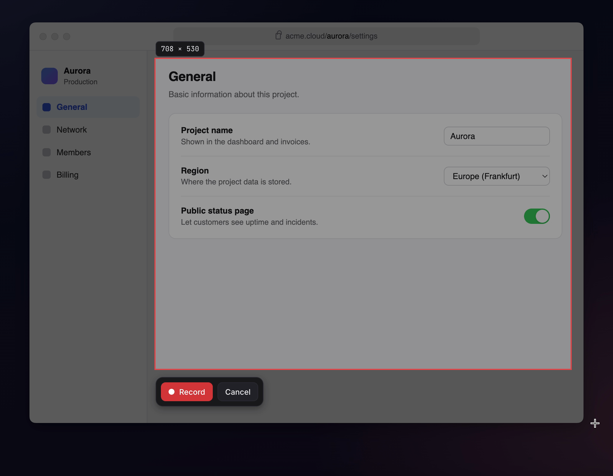
</p>
<p align="center">
  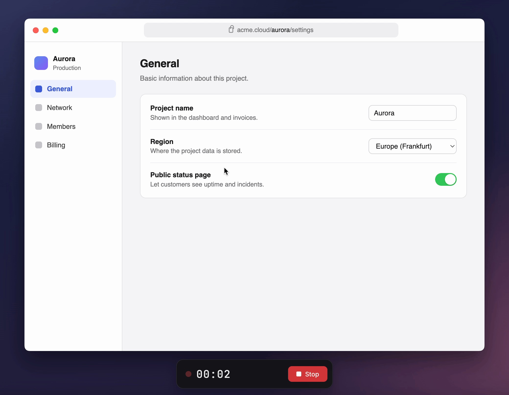
  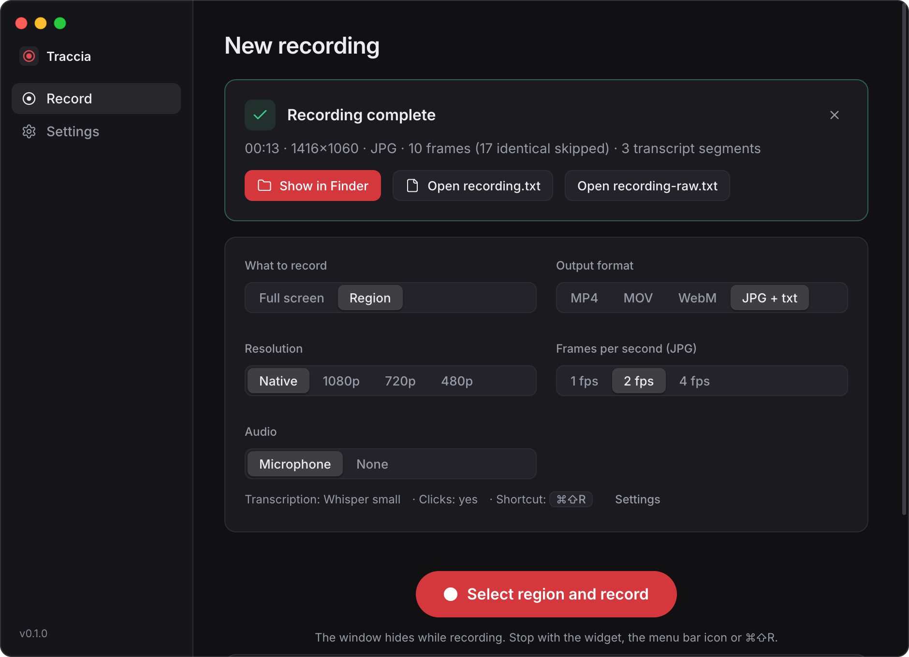
</p>
<p align="center">
  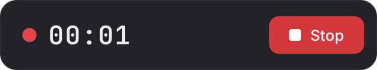
  &nbsp;&nbsp;&nbsp;
  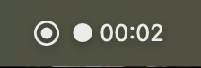
</p>

### Settings

<p align="center">
  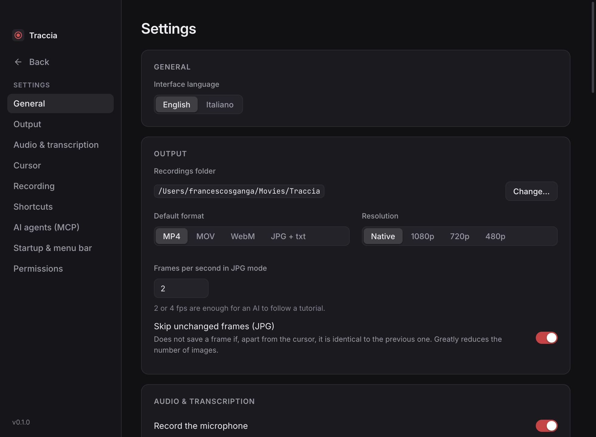
  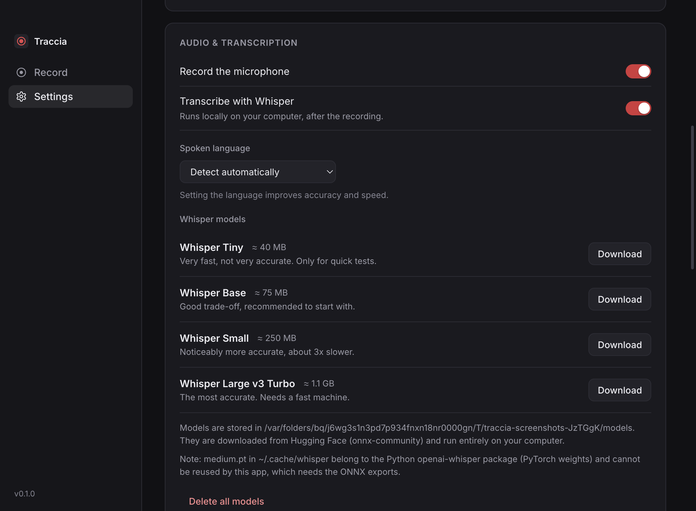
</p>
<p align="center">
  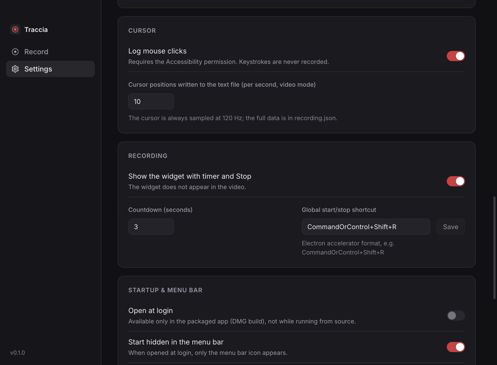
  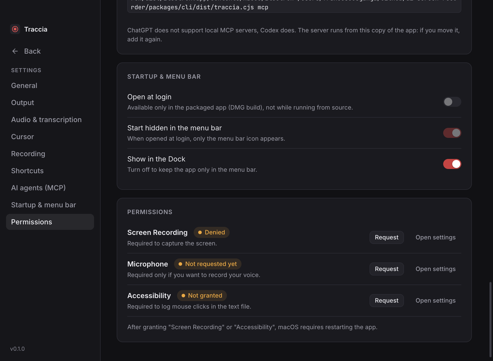
</p>

## Install

Download the DMG for your Mac from the [Releases page](../../releases/latest): `arm64` for Apple Silicon (M1 and later), `x64` for Intel. Open it and drag **Traccia** into Applications.

The DMGs are signed with a Developer ID certificate and notarized by Apple, so the app opens without warnings.

If you enable the shortcuts with the macOS screenshot keys (⇧⌘5, ⇧⌘4), macOS keeps handling them until you turn them off in **System Settings → Keyboard → Keyboard Shortcuts → Screenshots**; the app links to that pane. The alternative keys need no change.

## CLI & MCP

The app includes an [MCP](https://modelcontextprotocol.io) server and a command-line tool, so an AI agent can list the recordings, read their timeline and frames, and start or stop screen or audio-only conversation recordings without the app in front. Dictation is controlled from the app or its shortcut, not through these tools. Reading works on the files alone; starting and stopping talk to the running app through a local control socket.

### MCP server

**Settings → AI agents** registers the server with one click in Claude Code, Claude Desktop, Cursor or Codex, or copies the JSON for any other client and adds it to a config file you choose. Nothing else to install: the server is the copy of the app you are running, started by the client through the app's own binary in Node mode.

```json
{
  "mcpServers": {
    "traccia": {
      "command": "/Applications/Traccia.app/Contents/MacOS/Traccia",
      "args": ["/Applications/Traccia.app/Contents/Resources/app.asar/cli/traccia.cjs", "mcp"],
      "env": { "ELECTRON_RUN_AS_NODE": "1" }
    }
  }
}
```

The server offers:

- **tools** — `list_recordings`, `get_timeline` (clicks, or raw with the pointer movement), `get_transcript`, `get_frames` (JPEG images downscaled to 1024 px wide, spread over a time range, at most 30 per call), `get_status`, `start_recording`, `stop_recording`;
- **prompts** — `write_bug_report` and `explain_recording`: the timeline plus a handful of frames, with instructions;
- **resources** — `recording://<id>/recording.txt`, `recording-raw.txt`, `recording.json` and `recording://<id>/frames/<file>`.

Audio-only recordings return no frames. Frames of JPG recordings come straight from `frames/`; for video recordings the server extracts stills with the `ffmpeg` bundled in the app (or the one in the `PATH`, or `TRACCIA_FFMPEG`). Each image costs about a thousand tokens, which is why `get_frames` takes a time range and a maximum. ChatGPT does not support local MCP servers; Codex does.

### Command line

The same program is published on npm as [`traccia-cli`](packages/cli), for terminals and for machines without the app (an agent reading a synced recordings folder, for instance):

```bash
npx -y traccia-cli list                     # recordings in the output folder, newest first
npx -y traccia-cli show latest              # print recording.txt (--raw for recording-raw.txt, --json for the metadata)
npx -y traccia-cli status                   # what the app is doing
npx -y traccia-cli record start --format m4a --conversation --multi-speaker --system-audio
npx -y traccia-cli record start --jpg --no-audio --countdown 0   # the app must be running (--launch opens it)
npx -y traccia-cli record stop              # stop, wait for the files and print where they are
npx -y traccia-cli mcp                      # the MCP server, e.g. claude mcp add traccia -- npx -y traccia-cli mcp
```

`npm install -g traccia-cli` gives you a plain `traccia` command. A recording id is the folder name (`2026-09-18_08-51-52`), `latest`, or the path of a recording folder. `record start` takes `--region` (drag the area on screen, as from the app) or `--rect x,y,w,h`, `--display`, `--format`, `--fps`, `--resolution`, `--no-audio`, `--system-audio`, `--conversation`, `--multi-speaker`, `--no-transcribe` and `--countdown`; options you do not pass come from the app's settings, and the ones you pass apply to that recording only. `--json` makes every command machine-readable; `--dir` reads recordings from a folder other than the one in the settings. `traccia --help` lists everything.

### Control socket

While the app runs it listens on `~/Library/Application Support/traccia/control.sock` (a Unix socket, readable by the current user only) for one JSON object per line: `status`, `start`, `stop`, `settings`, `displays`; the protocol is in [src/shared/control.ts](src/shared/control.ts). Windows would need a named pipe instead; the app is macOS-only today, so that path is untested.

## Development

The code was written by me with heavy use of Claude Code. Every line has been read and understood; the architecture, the output format and the trade-offs are mine. Issues and PRs are welcome, and I answer them personally: [CONTRIBUTING.md](CONTRIBUTING.md) says how to propose a change.

Requires Node 20+ and the Xcode Command Line Tools on macOS. `npm run dev` and `npm run build` compile the bundled Swift text-insertion helper for the host architecture; users of the packaged app do not need Xcode.

```bash
npm install
npm run dev        # start the app with hot reload
npm run build      # production build into out/
npm run dist       # create the DMG in dist/ (signed only if a Developer ID certificate is in the keychain)
npm run typecheck
```

Quick end-to-end test without clicking through the UI (records 6 seconds of the primary display, then quits):

```bash
npm run build && TRACCIA_AUTOTEST=6 npx electron .
```

Useful variables: `TRACCIA_AUTOTEST_MODE=region` with `TRACCIA_AUTOTEST_REGION=x,y,w,h` (in points, relative to the display); `TRACCIA_FFMPEG=/path/to/ffmpeg` to use a different ffmpeg than the bundled one; `TRACCIA_USER_DATA=/some/dir` to run with a separate profile (settings, control socket, single-instance lock), for instance next to the installed app.

The CLI and the MCP server live in `packages/cli` (an npm workspace); `npm run build` bundles them into `packages/cli/dist/traccia.cjs` along with the app, and the packaged app carries that file as `app.asar/cli/traccia.cjs`. `npm run typecheck` and `npm test` cover them too.

UI screenshots for this README (wizard, home, settings) are regenerated with a throwaway profile and no screen-capture permission; the app follows the system appearance, `TRACCIA_SCREENSHOTS_THEME=dark` (or `light`) forces one:

```bash
npm run build && TRACCIA_SCREENSHOTS=docs/screenshots npx electron .
```

The design tokens and component rules live in [docs/design-system.md](docs/design-system.md).

### macOS permissions in development

In development the app runs inside `node_modules/electron/dist/Electron.app`, so macOS asks for permissions for "Electron": Screen Recording (for screen/system-audio capture), Microphone, Camera (for the webcam), Accessibility (for clicks and dictation insertion). Microphone-only dictation and Copy do not require Screen Recording or Accessibility. After granting Screen Recording or Accessibility the app must be restarted.

### Releases

Releases are built by GitHub Actions ([release.yml](.github/workflows/release.yml)): pushing a `v*` tag builds, signs and notarizes the arm64 and x64 DMGs on macOS runners and attaches them to a draft release, to be reviewed and published from the Releases page. Signing needs the repository secrets listed at the top of the workflow.

```bash
npm version patch   # or minor / major: bumps package.json and creates the tag
git push --follow-tags
```

The release notes are the `feat:` and `fix:` commits since the previous tag (`scripts/release-notes.sh HEAD` previews them); edit them in the draft before publishing.

Publishing the release on GitHub also publishes `traccia-cli` to npm, with the same version number ([publish-cli.yml](.github/workflows/publish-cli.yml), npm trusted publishing: no token in the repository).

## How it works

| Part | Technology |
|---|---|
| Video capture | `getDisplayMedia` + `MediaRecorder` (H.264 when available) in the renderer, chunks written to disk by the main process |
| Cursor | `screen.getCursorScreenPoint()` at 120 Hz in the main process |
| Clicks | [`uiohook-napi`](https://github.com/SnosMe/uiohook-napi) |
| Conversion, crop, scaling, JPG extraction | [`ffmpeg-static`](https://github.com/eugeneware/ffmpeg-static) (hardware `h264_videotoolbox` encoder on macOS) |
| Transcription | OpenAI Whisper models in ONNX format (the `_timestamped` exports from [onnx-community](https://huggingface.co/onnx-community), which provide word-level timestamps) run by [`@huggingface/transformers`](https://github.com/huggingface/transformers.js) in a utility process |
| UI | Electron + Vite + React + TypeScript |
| CLI and MCP server | plain Node, [`@modelcontextprotocol/sdk`](https://github.com/modelcontextprotocol/typescript-sdk), `sharp` to downscale frames; talks to the app over a Unix socket |

Layout: `src/main` (main process: recording session, ffmpeg, Whisper, timeline, control socket), `src/preload` (IPC bridge), `src/renderer` (UI, capture engine, region overlay, widget), `src/shared` (types, translations, the recording reader used by both the app and the CLI), `packages/cli` (CLI and MCP server).

Translations live in `src/shared/i18n.ts`; adding a language means adding a dictionary there.

## Roadmap

- [ ] Windows support.
- [ ] `whisper.cpp` backend on Apple Silicon.
- [ ] More interface languages.

## License

MIT — see [LICENSE](LICENSE).
